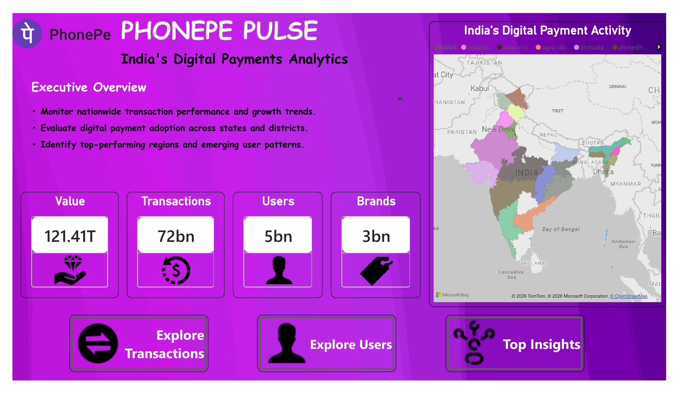
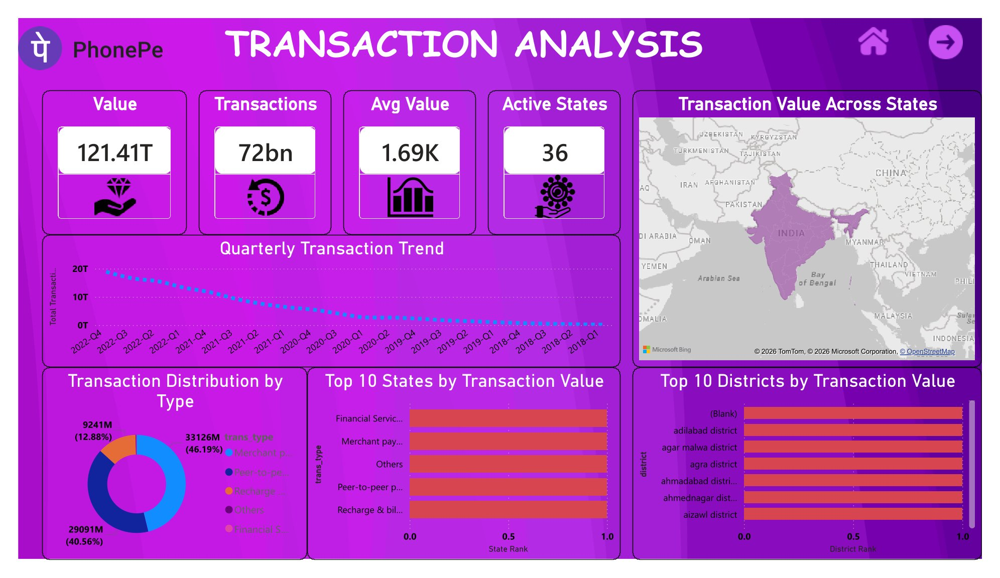
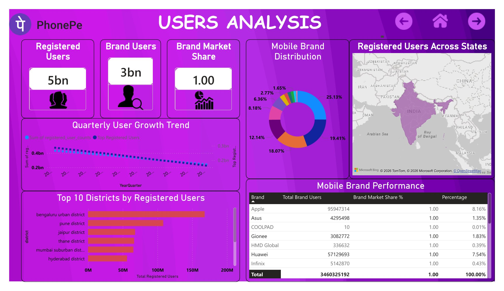
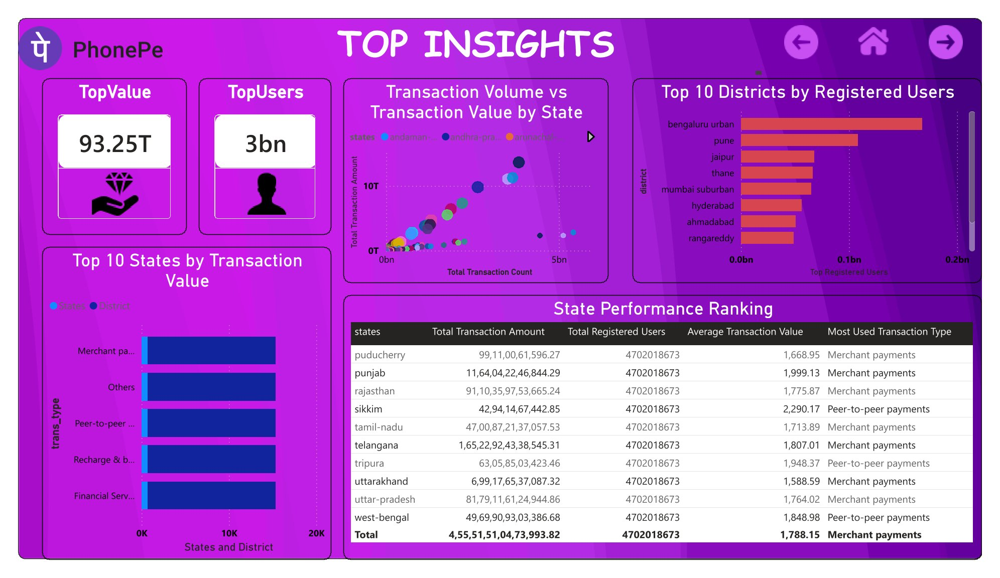
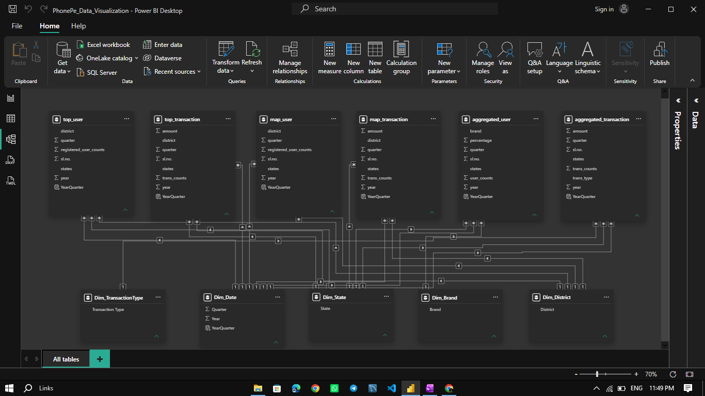
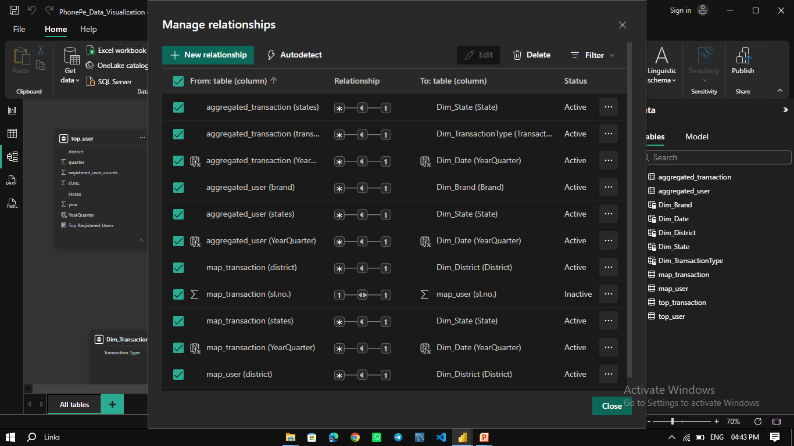

<p align="center">
  
</p>

<h1 align="center">PhonePe Visualization Dashboard</h1>

<h3 align="center">Digital Payment Analytics & Business Intelligence Using Power BI</h3>

<p align="center">
  <strong>Transforming Digital Payment Data into Actionable Business Insights</strong>
</p>

<p align="center">
  An interactive Power BI project exploring digital payment transactions, user growth, regional performance, and geographic trends.
</p>

<p align="center">
  
  
  
</p>

---

## 📑 Table of Contents

- [Project Overview](#-project-overview)
- [Business Objectives](#-business-objectives)
- [Tools and Technologies](#️-tools-and-technologies)
- [Dashboard Preview](#-dashboard-preview)
- [Dashboard Modules](#-dashboard-modules)
- [Analytical Workflow](#-analytical-workflow)
- [Key Business Questions](#-key-business-questions)
- [Repository Structure](#-repository-structure)
- [Installation and Usage](#-installation-and-usage)
- [Business Applications](#-business-applications)
- [Data Source and Disclaimer](#️-data-source-and-disclaimer)
- [Author](#-author)

---

## 📌 Project Overview

The **PhonePe Visualization Dashboard** is a Business Intelligence project developed using Microsoft Power BI Desktop to explore digital payment activity through interactive reports and visual analytics.

The project transforms structured transaction and user datasets into visual insights, enabling the exploration of transaction trends, regional performance, user adoption, and geographic differences in digital payment activity.

The dashboard demonstrates a practical analytics workflow involving data preparation, data modeling, KPI development, and interactive visualization.

The primary goal is to make complex data easier to understand and support data-driven analysis of digital payment patterns.

## 🎯 Business Objectives

- Analyze total transaction value and transaction volume.
- Explore transaction trends across available reporting periods.
- Compare state-wise and district-wise transaction performance.
- Examine registered users and device-related usage patterns.
- Investigate geographic differences in digital payment adoption.
- Develop interactive KPIs and visual reports.
- Present analytical findings through professional visualizations.

## 🛠️ Tools and Technologies

| Technology | Application |
|---|---|
| Microsoft Power BI Desktop | Dashboard development and visualization |
| Power Query | Data cleaning and transformation |
| DAX | Measures and KPI calculations |
| Data Modeling | Table relationships and analytical structure |
| Interactive Visualizations | Trend analysis and regional comparisons |

*The listed technologies reflect the intended workflow; retain only those used in the completed project.*

---

## 🖼️ Dashboard Preview

Explore the different components of the PhonePe Power BI project. All preview images are stored in the `preview/` directory.

### 1. 🏠 Home Page

The main dashboard landing page provides an overview of the report and access to its analytical sections.

<p align="center">
  
</p>

### 2. 💳 Transaction Analysis

Explore transaction value, transaction volume, and regional payment activity through interactive visuals.

<p align="center">
  
</p>

### 3. 👥 Users Analysis

Examine registered users and available user-related metrics to understand digital payment adoption.

<p align="center">
  
</p>

### 4. 💡 Top Insights

Review the dashboard's highlighted metrics and analytical findings.

<p align="center">
  
</p>

### 5. 🗂️ Data Model

View the data model used to organize the project's datasets and analytical fields.

<p align="center">
  
</p>

### 6. 🔗 Table Relationships

Inspect the relationships established between the relevant data tables.

<p align="center">
  
</p>

---

## 📊 Dashboard Modules

### Executive Overview
Provides a consolidated view of key performance indicators and overall transaction activity.

### Transaction Analysis
Explores transaction value, transaction count, and trends across available reporting periods.

### User Analysis
Examines registered users and available user-related metrics.

### Geographic and Regional Analysis
Supports state-level and district-level comparisons to explore geographic differences in payment activity.

### Top Insights
Highlights selected KPIs and findings derived from the available dataset.

### Data Model and Relationships
Documents the organization of data tables and the relationships supporting the report.

*Module descriptions should match the pages and features implemented in the final Power BI file.*

## 🔄 Analytical Workflow

The project follows a structured Business Intelligence process:

1. **Data Collection** — Identify and organize the available transaction and user datasets.
2. **Data Preparation** — Review data types, missing values, inconsistencies, and formatting.
3. **Data Transformation** — Prepare the datasets using Power Query.
4. **Data Modeling** — Establish suitable table relationships and organize analytical fields.
5. **KPI Development** — Create relevant measures and calculations using DAX.
6. **Dashboard Development** — Build KPI cards, charts, comparisons, and interactive report pages.
7. **Validation** — Check calculations, relationships, filters, and visual consistency.
8. **Business Analysis** — Explore patterns and communicate findings from the dashboard.

## 💡 Key Business Questions

The dashboard can be used to investigate:

- How does transaction value change over time?
- How does transaction volume vary across reporting periods?
- Which states and districts have the highest transaction activity?
- How is registered-user activity distributed across regions?
- What geographic differences appear in digital payment adoption?
- Which regions warrant further analytical investigation?

Answers should be based on actual dashboard results and the coverage of the available dataset.

## 📁 Repository Structure

```text
PhonePe-Visualization/
│
├── README.md
│
├── dashboard/
│   └── PhonePe Dashboard.pbix
│
├── preview/
│   ├── home-page.png
│   ├── transaction-analysis.png
│   ├── users-analysis.png
│   ├── top-insights.png
│   ├── data-model.png
│   └── Relationship.png
│
└── data/
    └── README.md
```

### Directory Guide

| Directory / File | Description |
|---|---|
| `README.md` | Project documentation |
| `dashboard/` | Power BI report file |
| `preview/` | Dashboard and data model screenshots |
| `data/` | Dataset documentation, source, and usage notes |

This is the recommended structure. Keep the directory names and image filenames consistent with your actual GitHub repository.

## 🚀 Installation and Usage

### Prerequisites

- Microsoft Power BI Desktop.
- Access to the original dataset if a data refresh is required.
- A Windows environment compatible with Power BI Desktop.

### Step 1: Clone the Repository

Replace `YOUR-USERNAME` with your GitHub username.

```bash
git clone https://github.com/YOUR-USERNAME/PhonePe-Visualization.git
```

### Step 2: Navigate to the Project Directory

```bash
cd PhonePe-Visualization
```

### Step 3: Open the Dashboard

Navigate to the `dashboard/` folder and open `PhonePe Dashboard.pbix` in Microsoft Power BI Desktop.

### Step 4: Configure the Data Source

If Power BI displays a data-source error, update the source paths to match the location of your original dataset.

### Step 5: Refresh and Explore

Refresh the data if the required files and connections are available. Explore the report pages, slicers, filters, and interactive visualizations.

> **Note:** Refreshing the report requires access to the underlying data sources and a valid configuration.

## 📈 Business Applications

The analytical techniques demonstrated in this project can support:

- Monitoring transaction performance across geographic regions.
- Comparing digital payment activity across reporting periods.
- Exploring regional differences in user adoption.
- Identifying high-activity and lower-activity areas for further investigation.
- Presenting key metrics through a centralized reporting interface.
- Communicating data-driven observations to business stakeholders.

These are potential applications of the analytical approach, not claims of measured business impact.

## ⚠️ Data Source and Disclaimer

This is an independent educational and portfolio project developed to demonstrate data analytics and dashboard development skills.

- **Brand ownership:** PhonePe is a trademark of its respective owner. This project is not affiliated with, sponsored by, or endorsed by PhonePe.
- **Dataset attribution:** Document the original dataset publisher, source URL, coverage period, and applicable license in `data/README.md`.
- **Data coverage:** Findings are limited to the records and reporting periods available in the dataset.
- **Interpretation:** Results should not be generalized to all PhonePe transactions unless the source data supports that conclusion.
- **Data privacy:** Do not upload confidential, personal, or restricted information.

## 👨‍💻 Author

**Ayush Dash**

*Data Analytics | Business Intelligence | Power BI*

Focused on transforming data into meaningful insights through analytical thinking, data visualization, and business-oriented reporting.

---

## ⭐ Support

If you find this project useful for learning Power BI or exploring digital payment analytics, consider giving the repository a star.

**Thank you for visiting the PhonePe Visualization Dashboard!**
